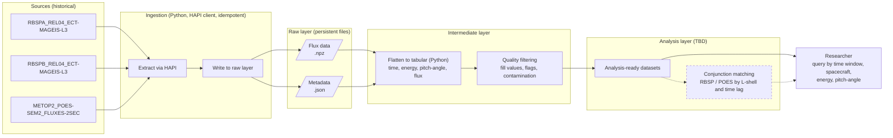
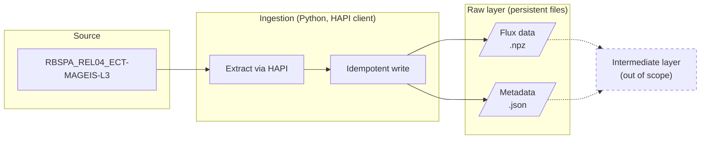

# Project Brief
Sunday, 08 Nov. 2026

## Background

### Motivations

I am reviving an old project I had attempted as an undergraduate working with a scientist. From what I can piece together from memory and scraps of notes and scripts, what we wanted to do was read particle flux data from two sources: [NASA's Van Allen Probes (RBSP)](https://svs.gsfc.nasa.gov/3951/) and [NOAA's POES (Polar Operational Environmental Satellites)](https://www.ospo.noaa.gov/operations/poes/) and compare their values at a point in space.

### Scientific context
The Van Allen probes travel in a near-equatorial orbit across different [L-shells](https://en.wikipedia.org/wiki/L-shell)--thus they are able to capture the environment across the inner and outer radiation belts. The POES satellites travel in LEO (low-earth orbit), they can measure precipitating particles (1). These high-energy particles are usually trapped along magnetic field lines around the earth (hence the term "radiation belts"), but there exists different phenomena that can cause them to "precipitate" or escape from these radiation belts into Earth's upper atmosphere.

1. [Electron precipitation (Wikipedia)](https://en.wikipedia.org/wiki/Electron_precipitation)

## Problem Statement

### Scientific

Please note that currently, the exact scientific objectives of the original project are still unclear to me. Poring through my old notes and scripts, I've made a working assumption which I'm taking to be the goal for now. I suspect I will slowly uncover the original aim or verify this postulate as this project goes along, or that I may find papers with similar premise to emulate (2).

> **Working assumption** The idea here is to see if we can observe particle precipitation by comparing flux measurements that the RBSP satellites capture at a certain magnetic field line with the flux values that the POES satellite captures at that same magnetic field line, at some amount of time* later.

<small>*This leads me to another question which could be a secondary objective: roughly how long does this precipitation take? On the order of hours? Days?</small>

<small>2. _I found a paper that I think presents a very interesting ML application of our DE work here as well!_</small> ["Reconstructing Equatorial Electron Flux Measurements From Low-Earth-Orbit: A Conjunction Based Framework" (2025, Stumbaugh et al)](https://agupubs.onlinelibrary.wiley.com/doi/full/10.1029/2024SW004249)

### Engineering
Despite the remaining ambiguity in our scientific goals, there is a clear data engineering problem emerging here: these satellite flux data are high-resolution time-series data and in our case, the shape of our data is multi-dimensional. These flux measurements are binned by energy and pitch-angle. Our science objectives require us to massage this data in a format that will enable us to do some analytics. With data this complex and voluminous (3), it would hinder our study to extract, load in memory, and process / transform in batches just using Pandas alone (4), especially as the exploratory nature of this project requires repeated processing.

For now we are working with historical data--these missions ended around 2019-early 2020s so we don't expect to ingest any real-time data from these satellites. Should our findings lead to more questions in the future, we may also have a need to ingest more types of data that might be ongoing (e.g. derived data like [Planetary K-index](https://www.spaceweather.gov/products/planetary-k-index)).

<small>3. _The Van Allen Probes/RBSP missions ran from 2012-2019. The resolution of the MagEIS electron flux data is about 11s. This corresponds to roughly 20.4M data points across its lifetime for just one of the probes (of which there are two). For POES, we have even higher (2s) resolution data. That would be equivalent to 43k data points per day, or >110M across 7 years._</small>

<small>4. _My naive approach six years ago. Even working with a supercomputer, this approach was highly inefficient._</small>

### Use Case

I want to approach this problem from a realistic perspective: I am one scientist who has a question to answer, a paper to write. This question and its answer can lead to more questions, and more reasons to want to revisit and play with the data I'm looking at. I am also limited in time and resources, that is--limited in funding, in personnel--and I only have my personal laptop to use for this.

This data platform should allow me to:
- query and retrieve flux measurements across different energy bins and pitch-angles
- query for values within a specified time window or from a specific spacecraft
- do analysis
- retrieve metadata associated with the measurements
- incorporate another dataset later

## Engineering Objectives

### Long-term goals
Our general engineering objective is to be able to extract the necessary data from these satellites and create persistent datasets for a researcher to explore and build transformation pipelines on top of for current and future use cases.

It follows that:
- Metadata should be ingested and stored, because it provides important context about how to interpret the measurements.
- Transformations of the data should be traceable: we should be able to justify every step of any calculation we derive. This is necessary to preserve and defend the integrity of any findings that emerge from our study.
- The system should be accessible, inexpensive, and reproduceable. Any collaborator should be able to set this up reasonably easily. We should assume everyone working with this data is limited to normal computing power and funding.
- The data model should make sense for our current use case. Ideally, it should be reasonable for other investigations as well.
- The process should be idempotent: running it multiple times should not create duplicate data.

#### Rough Outline

#### Data
With regard to our investigation, we're looking to ingest specifically the following data products:

Data Products | Satellite | Reference | Description |
| ----- | ----- | ----- | ----- |
| `RBSPA_REL04_ECT-MAGEIS-L3` | RBSP-A | [cdaweb.gsfc.nasa.gov](https://cdaweb.gsfc.nasa.gov/misc/NotesR.html#RBSPA_REL04_ECT-MAGEIS-L3) | Level 3 Pitch Angle sorted electron and proton flux data from RBSP-ECT/MagEIS instrument (Magnetic Electron Ion Spectrometer), from probe A. This also contains "MagEphem" (magnetic ephemerides) data, which are magnetic coordinates data that is needed to contextualize our flux data. |
| `RBSPB_REL04_ECT-MAGEIS-L3` | RBSP-B | [cdaweb.gsfc.nasa.gov](https://cdaweb.gsfc.nasa.gov/misc/NotesR.html#RBSPB_REL04_ECT-MAGEIS-L3) | The same as above, but for probe B. |
| `METOP2_POES-SEM2_FLUXES-2SEC` | POES | [cdaweb.gsfc.nasa.gov](https://cdaweb.gsfc.nasa.gov/misc/NotesM.html#METOP2_POES-SEM2_FLUXES-2SEC) | POES/MetOp particle precipitation data. Important flag: "These data have known contamination problems. Please consult provider for usage recommendations.)" |

These satellites have all been decommissioned so we are only dealing with historical data.

For more context:
- "MagEIS" (Magnetic Electron Ion Spectrometer) is the name of the instrument in the RBSP probes that measure flux for electrons and ions within a certain energy range (medium-to-high energies). It is one of the three instruments in the "RBSP-ECT" suite (Energetic Particle, Composition, and Thermal Plasma Suite).
- "SEM-2" (Space Environment Monitor-2) is a similar spectrometer that measures electron and ion fluxes onboard POES, which is near the Earth's upper atmosphere.

### Short-term goals / Current scope

As of Nov. 07, 2026, I have a time constraint of 48 hours and a resource constraint in that I will not use AI to implement this project.

**My success criteria for this weekend is then:**

1. Figure out the general idea for our scientific goals.
2. Research available RBSP and POES data products and identify which ones are relevant for our use case.
3. Determine the shape of the data engineering problem.
4. Write a project brief that outlines the overarching scientific and engineering goals, its scope.
5. Implement a small, local ETL pipeline for RBSP-A MagEIS flux data that establishes a pattern for other ingestions.
    - Write a technical design document that goes through the implementation, outlines open questions and decisions made.

**Out of scope at this stage:**
- RBSP-B MagEIS flux and POES flux ingestions
- Implementation of the data pipeline beyond the raw layer (i.e., no downstream transformations, other scientific analysis, intermediate data models)

#### Diagram

#### Data
For this goal, we are only looking at one data product:

Data Products | Satellite | Reference | Description |
| ----- | ----- | ----- | ----- |
| `RBSPA_REL04_ECT-MAGEIS-L3` | RBSP-A | [cdaweb.gsfc.nasa.gov](https://cdaweb.gsfc.nasa.gov/misc/NotesR.html#RBSPA_REL04_ECT-MAGEIS-L3) | Level 3 Pitch Angle sorted electron and proton flux data from RBSP-ECT/MagEIS instrument (Magnetic Electron Ion Spectrometer), from probe A. This also contains "MagEphem" (magnetic ephemerides) data, which are magnetic coordinates data that is needed to contextualize our flux data. |
