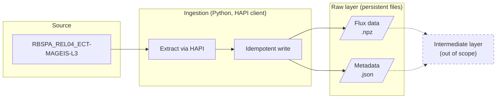

# Technical Design Document: Initial RBSP-MagEIS ETL
07 Nov. - 08 Nov. 2026

## Goals
This document serves to outline a simple, local ETL pipeline that ingests MagEIS data (electron flux alongside MagEphem coordinates) for only one satellite (RBSP-A) within a time-bounded window. It is a very thin slice of a more expansive data platform, and is meant to establish a pattern for other ingestions to follow.

## Design Overview

## Implementation

**Extraction**
We ingest the MagEIS data products through [HAPI (Heliophysics DATA API)](https://hapi-server.org) Python client and the CDAWeb server (`https://cdaweb.gsfc.nasa.gov/hapi/`). We extract all possible fields. We [partition the user's requested time window to 1-day intervals](design_decisions.md) to limit request size. It is worth nothing that I did not implement error handling at this stage--this will be a priority for next steps.

**Writing to file**
The response we get from HAPI is bound to a single day \[start date, end date\). For the actual measurements and the metadata alike, each run writes 1 file per single-day partition to the `data/raw/` or `data/meta/` directories. Each file is binned by spacecraft/instrument/data level/year/month and the file name is the zero-padded day. Measurements are stored as NPZ files, largely because HAPI returns multi-dim arrays for the values, and metadata is stored as JSON files, as HAPI returns that as a Python dict.

Example: `data/raw/rbsp-a/mageis/l3/2013/06/13.npz`

**Idempotency**
On a rerun, any existing files are overwritten. Because these files are named based on their date, a request with the same or overlapping time ranges yields the same file name. It is worth revisiting other approaches.

**Testing**
We implement two tests, one to check that the upper bound of each datetime tuple does not exceed `stop_date`, and one to check that saving to `.npz` format and loading it back preserves the data (values, shape, data type).

## Design decisions
See [docs/design_decisions.md](design_decisions.md).

## Open questions
- How are missing values or invalid values represented in the data? (i.e., if the instrument spazzes out and measurements become very saturated, how can we tell?)
- Other ways to approach idempotency?
- More optimal batch size?
- How can we verify we've obtained all possible data at extraction?
- How do we interpret fill values?
- Do we ever have a case of measurements / values being revised?

## Known limitations
- No API error handling
- Very incomplete testing
- No validation of user-set config values
